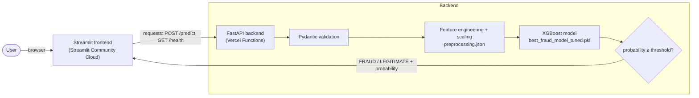

# 🛡️ Bank Fraud Detection: End-to-End ML Application

A machine-learning fraud detector served through a **FastAPI** REST API and a **Streamlit** web UI.
A tuned **XGBoost** model scores a single bank transaction and returns a fraud probability and a
FRAUD / LEGITIMATE decision.

> **Model artifacts are ready.** `backend/model/preprocessing.json` has been generated from
> `data/Fraud.csv` and verified against the saved model's notebook results. Keep that file alongside the model for deployment.

---

## Table of contents
1. [Overview](#overview) · 2. [Key features](#key-features) · 3. [Tech stack](#technology-stack) · 4. [Architecture](#architecture) · 5. [Folder structure](#folder-structure)
6. [Local setup (Windows)](#local-setup-windows) · 7. [Configuration](#configuration-api_url-and-secrets) · 8. [API reference](#api-reference)
9. [Deployment](#deployment) · 10. [Model details](#model-details) · 11. [Limitations](#known-limitations) · 12. [Security](#security-and-data-privacy-notes) · 13. [Future work](#future-improvements) · 14. [License](#license)

---

## Overview

**Problem.** Fraudulent transactions are extremely rare (0.13% in the training data) but costly. Rule-based
systems miss most of them: in the dataset, the existing rule flagged only 0.0003% of transactions.

**Objectives.**
- Train a classifier that finds most fraud (high recall) while keeping false alarms manageable.
- Expose it as a validated, testable REST API.
- Provide a simple UI so a non-technical user can try transactions.
- Make the whole thing reproducible and deployable with Vercel (backend) and Streamlit Community Cloud (frontend).

## Key features
- **Faithful preprocessing.** The API accepts the *raw* transaction (7 fields); all feature engineering and scaling
  from the notebook is reproduced server-side.
- **Strict validation** with Pydantic: types, ranges, allowed transaction types, unknown fields rejected (`422`).
- **Fails safe.** Missing/invalid model artifacts → `503` with a precise message, never a silently wrong score.
- **Privacy-aware logging.** The backend logs the transaction type, prediction and probability, never amounts or balances.
- **Streamlit UI** with example transactions, backend status indicator and graceful handling of timeouts / cold starts.
- Optional API-key protection (`X-API-Key`) and a health check.

## Technology stack
Python 3.12 · FastAPI + Uvicorn · Pydantic · Pandas / NumPy · scikit-learn (split + scaler) · XGBoost (CPU build) · Joblib ·
Streamlit + Requests · Git/GitHub · Vercel (backend) · Streamlit Community Cloud (frontend)

## Architecture



The browser only talks to Streamlit; Streamlit's *server* calls the API with `requests`. Therefore **CORS is not needed
and is not enabled.**

## Folder structure

```
fraud-detection/
├── data/
│   └── Fraud.csv                     # local training data; excluded from Git
├── backend/
│   ├── main.py                       # FastAPI app: GET /, GET /health, POST /predict
│   ├── predictor.py                  # artifact loading + notebook-identical preprocessing + inference
│   ├── schemas.py                    # Pydantic request/response models
│   ├── requirements.txt
│   └── model/
│       ├── best_fraud_model_tuned.pkl   # YOUR trained model (unmodified)
│       ├── preprocessing.json           # verified scaler, p99, and type classes
│       └── README.md
├── frontend/
│   ├── app.py                        # Streamlit UI
│   └── requirements.txt
├── scripts/
│   └── export_preprocessing.py       # regenerates the preprocessing artifact + self-verifies
├── notebooks/
│   └── Bank_fraud_detection.ipynb    # original training notebook (unmodified)
├── .streamlit/
│   ├── config.toml                   # theme (must live at repo root for Streamlit Cloud)
│   └── secrets.toml.example
├── .gitignore
├── render.yaml                       # optional Render Blueprint
├── LICENSE
└── README.md
```

> `.streamlit/` is at the repository root rather than in `frontend/` because Streamlit Community Cloud only reads
> `config.toml` from the root of the repo, even if the app file is in a sub-folder.

---

## Local setup (Windows)

### Prerequisites
- **Python 3.12** (the pinned dependency set requires it). Check with `py -0`.
- Git, Python 3.12, and `data/Fraud.csv` only if you regenerate the preprocessing artifact.

### 1. Create a virtual environment

PowerShell, from the repository root:

```powershell
py -3.12 -m venv .venv
.\.venv\Scripts\Activate.ps1        # if blocked:  Set-ExecutionPolicy -Scope CurrentUser RemoteSigned
python -m pip install --upgrade pip
```
(`cmd.exe`: `.venv\Scripts\activate.bat`)

### 2. Install dependencies
```powershell
pip install -r backend/requirements.txt
pip install -r frontend/requirements.txt
```
Each deployed service installs only its own requirements file.

### 3. Generate the preprocessing artifact (only if needed)

The `backend/model/preprocessing.json` artifact has already been generated and verified locally, so you can skip this step to run the app. Make sure to include it alongside the model for deployment. To regenerate it, `data/Fraud.csv` and the backend dependencies are required. The exporter processes 6.36 million rows and can use several GB of memory.

**Why:** the model was trained on features scaled with a `RobustScaler`, with `type` label-encoded and
`is_high_amount` derived from the 99th percentile of `amount`. None of that was saved in the `.pkl`.

**Option A: script (recommended).** Re-runs your notebook's preprocessing exactly (same split, `random_state=42`),
then **verifies** it by scoring the reproduced test split with your model and comparing to the confusion matrix your
notebook printed (TP 1474, FN 169, FP 3612, TN 1267269). It writes the file only if that check passes.

```powershell
python scripts/export_preprocessing.py
```
The script uses `data/Fraud.csv` by default; use `--data C:\path\to\Fraud.csv` to select another path.
Expected: several `[PASS]` lines and `Wrote ...\backend\model\preprocessing.json`. If it reports `FAIL`, your dataset
differs from the one used for training and the file is *not* written.

**Option B: from the notebook** (only if the kernel that trained the saved model is still alive). Run in a new cell:
```python
import json
pre = {
    "schema_version": 1,
    "features": X_train.columns.tolist(),
    "scaler_center": scaler.center_.tolist(),
    "scaler_scale": scaler.scale_.tolist(),
    "amount_p99": float(p99),
    "type_classes": le.classes_.tolist(),
    "meta": {"note": "exported from the notebook session"},
}
with open("preprocessing.json", "w") as f:
    json.dump(pre, f, indent=2)
```
then move the file to `backend/model/preprocessing.json`.

### 4. Start the backend
```powershell
cd backend
uvicorn main:app --reload --port 8000
```
Open <http://127.0.0.1:8000/docs> (interactive Swagger UI) and <http://127.0.0.1:8000/health> (should show `"status": "ok"`).

### 5. Start the frontend (new terminal, repo root, venv activated)
```powershell
copy .streamlit\secrets.toml.example .streamlit\secrets.toml     # contains API_URL = "http://127.0.0.1:8000"
streamlit run frontend/app.py
```
Open <http://localhost:8501>. The sidebar should show **🟢 Online**.

---

## Configuration: `API_URL` and secrets

| Variable | Where | Purpose |
|---|---|---|
| `API_URL` | Frontend | Backend base URL, **required**; there is no hard-coded default. |
| `API_KEY` | Both (optional) | If set on the backend, clients must send `X-API-Key`. Set the same value in the frontend. |
| `REQUEST_TIMEOUT` | Frontend (optional) | Seconds to wait for the backend (default 60). |
| `PORT` | Local backend | Optional Uvicorn port; defaults to 8000. Vercel manages function routing. |
| `LOG_LEVEL`, `MODEL_PATH`, `PREPROCESSING_PATH` | Backend (optional) | Optional backend configuration. |

The frontend reads `API_URL` from **Streamlit secrets first, then the environment**:

- **Locally:** `.streamlit/secrets.toml` (git-ignored, copy of `secrets.toml.example`), or in PowerShell
  `$env:API_URL = "http://127.0.0.1:8000"` before `streamlit run`.
- **Streamlit Community Cloud:** *App settings → Secrets*: `API_URL = "https://<your-vercel-project>.vercel.app"`.

The apps do not load `.env` files automatically; configure these values as environment variables or through the hosting platform.

---

## API reference

Interactive docs: `/docs`. All numeric fields are **raw dataset values**. Field names match the dataset columns,
including its spelling (`oldbalanceOrg` vs `newbalanceOrig`).

### `GET /`
```json
{"service": "Fraud Detection API", "status": "running", "version": "1.0.0", "docs": "/docs"}
```

### `GET /health`
`200` when the model and preprocessing are loaded, `503` otherwise.
```json
{"status": "ok", "model_loaded": true, "preprocessing_loaded": true, "detail": null}
```

### `POST /predict`

| Field | Type | Rule |
|---|---|---|
| `step` | int | 1-743 (hour of the simulated month) |
| `type` | string | `CASH_IN`, `CASH_OUT`, `DEBIT`, `PAYMENT`, `TRANSFER` (case-insensitive) |
| `amount`, `oldbalanceOrg`, `newbalanceOrig`, `oldbalanceDest`, `newbalanceDest` | float | 0 to 1e12, finite |

Request (this is row 2 of your notebook's data preview, labelled fraud in the dataset):
```json
{
  "step": 1,
  "type": "TRANSFER",
  "amount": 181.0,
  "oldbalanceOrg": 181.0,
  "newbalanceOrig": 0.0,
  "oldbalanceDest": 0.0,
  "newbalanceDest": 0.0
}
```
Actual response for the example request:
```json
{
  "prediction": "FRAUD",
  "is_fraud": true,
  "fraud_probability": 0.991884,
  "decision_threshold": 0.908351,
  "model_name": "XGBoost"
}
```
`is_fraud` is `fraud_probability >= decision_threshold` (the notebook's rule).

| Status | Meaning |
|---|---|
| 200 | Prediction returned |
| 401 | Missing/invalid `X-API-Key` (only if `API_KEY` is configured) |
| 422 | Invalid payload: wrong type, out-of-range, missing/unknown field |
| 503 | Model or preprocessing artifact not loaded; see `/health` |
| 500 | Unexpected error (details only in server logs) |

Try it from PowerShell (note: plain `curl` is an alias for something else in PowerShell):
```powershell
Invoke-RestMethod -Method Post -Uri http://127.0.0.1:8000/predict -ContentType "application/json" `
  -Body '{"step":1,"type":"TRANSFER","amount":181,"oldbalanceOrg":181,"newbalanceOrig":0,"oldbalanceDest":0,"newbalanceDest":0}'
```

---

## Deployment

Deploy the **FastAPI backend first** (the Streamlit app needs its URL). Both services deploy from GitHub.

### Push to GitHub
```powershell
git init
git add .
git status        # CONFIRM: model and preprocessing.json are listed; data/Fraud.csv, secrets.toml, .env are NOT
git commit -m "Fraud detection app"
git branch -M main
git remote add origin https://github.com/<your-username>/fraud-detection.git
git push -u origin main
```
Edit `LICENSE` first (replace `<YOUR NAME>`). **Commit `backend/model/preprocessing.json`**: the API needs it, and it holds
only summary statistics (medians, IQRs, one percentile), no transaction data.

*If a future model exceeds GitHub's 100 MB file limit:* use Git LFS, attach it to a GitHub Release and download it in the build
command, or host it on Hugging Face Hub / S3 and download at build time.

### Deploy the backend on Vercel
1. In Vercel, **Add New → Project** and import the GitHub repository.
2. Set **Root Directory** to `backend`. This makes `main.py`, `predictor.py`, `schemas.py`, `requirements.txt`, and both model artifacts available to the function while keeping the 470 MB local dataset outside the deployment.
3. Use the Python 3.12 runtime. Vercel detects the FastAPI `app` in `main.py` and installs `backend/requirements.txt`; no Uvicorn start command is needed.
4. In the Vercel project **Settings → Environment Variables**, optionally set `API_KEY` to a long random value. Set it for Production and Preview as appropriate.
5. Deploy, then check `https://<your-project>.vercel.app/health`. Expect HTTP 200 with `model_loaded` and `preprocessing_loaded` both `true`.

Vercel currently documents Python runtimes and FastAPI support, a 500 MB uncompressed Python function bundle limit, and 2 GB memory on Hobby functions. The model files are small, but packages such as XGBoost, SciPy, NumPy and scikit-learn make the deployment build the final check for bundle size and Linux compatibility. The local Windows environment and smoke test do not verify a Vercel-hosted deployment.

### Deploy the frontend on Streamlit Community Cloud
1. Go to <https://share.streamlit.io> → **Create app** → select your GitHub repo and branch.
2. **Main file path:** `frontend/app.py` (dependencies are picked up from `frontend/requirements.txt`).
3. **Advanced settings:** Python version **3.12**; in **Secrets** paste:
   ```toml
   API_URL = "https://<your-project>.vercel.app"
   # Uncomment only if API_KEY is configured on Vercel:
   # API_KEY = "same-long-random-value-as-vercel"
   ```
4. **Deploy.** The sidebar status should turn 🟢 Online.

`API_KEY` is optional, but the API is public if you do not set it. When enabled on Vercel, use the same secret in Streamlit Community Cloud.

The existing `render.yaml` is retained only as an alternative backend deployment option; it is not used by Vercel.

### Final checklist: is the deployed app working?
- [ ] `https://<your-project>.vercel.app/` returns `{"status": "running", ...}`
- [ ] `https://<your-project>.vercel.app/health` returns **200** with `model_loaded` and `preprocessing_loaded` both `true`
- [ ] `https://<your-project>.vercel.app/docs`: *Try it out* on `POST /predict` with the sample body returns 200
- [ ] An invalid body (e.g. `"amount": -1`) returns **422**
- [ ] Streamlit app loads and the sidebar shows 🟢 Online
- [ ] Clicking *Analyze transaction* shows a probability and decision
- [ ] The dataset-labelled **fraud** examples (rows 2 and 3) are sanity-checked: record what the model says rather than assuming
- [ ] Vercel function logs show `prediction type=... result=...` lines **without** amounts or balances
- [ ] `.streamlit/secrets.toml` and `.env` are **not** in your GitHub repo

---

## Model details

All numbers below are taken from the saved outputs of `notebooks/Bank_fraud_detection.ipynb`. Nothing was re-estimated.

**Data.** 6,362,620 transactions × 11 columns; 8,213 fraudulent (0.1291%). Columns and size match the public **PaySim**
synthetic mobile-money dataset (please confirm the source and cite it here). Split 80/20, stratified, `random_state=42` → test set of
1,272,524 transactions containing 1,643 frauds.

**Features (9, in this order).** `step`, `amount`, `log_amount`, `is_high_amount` (amount > 99th percentile), `hour` (`step % 24`),
`is_night` (hours 22-05), `balance_diff_orig` (old − new sender balance), `balance_diff_dest` (new − old recipient balance),
`type_enc` (label-encoded type). All 9 are scaled with a `RobustScaler` fitted on the training split.

**Model.** `XGBClassifier`: 200 trees, `max_depth=4`, `learning_rate=0.05`, `subsample=0.8`, `colsample_bytree=0.8`,
`min_child_weight=50`, `scale_pos_weight≈773.75` (class imbalance), `tree_method=hist`.

**Model comparison on the test split (tuned models, notebook cell outputs):**

| Model | ROC-AUC | PR-AUC |
|---|---|---|
| **XGBoost (saved)** | **0.9982** | **0.8617** |
| Random Forest | 0.9978 | 0.8329 |
| Logistic Regression | 0.9775 | 0.5504 |

**Saved model at the saved decision threshold (0.9084), test split:**

| | Count |
|---|---|
| Fraud caught (TP) | 1,474 |
| Fraud missed (FN) | 169 |
| False alarms (FP) | 3,612 |
| Legitimate passed (TN) | 1,267,269 |

Recall **0.897**, precision **0.290** (both printed by the notebook). Derived from the table: 5,086 transactions flagged in
total; F1 ≈ 0.438.

> **Note on the notebook's commentary.** Some markdown text in the notebook quotes "~35% precision" and "PR-AUC ≈ 0.88".
> Those figures belong to the *untuned* XGBoost used to pick the threshold. The numbers above are for the model actually
> saved in the `.pkl`. Consider updating that text in the notebook.

## Known limitations
- **Synthetic data.** PaySim is simulated; real-world performance is unknown and would need re-validation.
- **Optimistic evaluation.** The threshold was chosen on the *same test set* used to report results, and it was selected using the untuned
  model's score distribution, then applied to the tuned model. A clean estimate needs a separate validation split.
- **`step` is a feature.** It is a simulation time index (1-743), which has no direct equivalent for live transactions. The UI asks for it explicitly.
- **Post-transaction balances** are used as inputs; a real-time system may not have them at decision time.
- **Random split**, not time-based; potential leakage across time is not assessed.
- **Precision is low by design** (0.29): about 7 of 10 flags are false alarms at this high-recall threshold.
- Single-transaction scoring only; no batch endpoint, monitoring, drift detection or retraining pipeline.
- The model is a pickle created with an older XGBoost; it loads and predicts under the pinned `xgboost-cpu==2.1.4`.
- Free-tier cold starts (see above).

## Security and data privacy notes
- **Pickle safety.** Only load model files you created or fully trust; unpickling can execute arbitrary code.
- **No transaction data is stored or logged.** Logs contain the transaction type, decision and probability only.
- **Secrets** (`API_KEY`, `secrets.toml`, `.env`) are git-ignored. Set them in the Vercel / Streamlit dashboards.
- The public API is **unauthenticated by default**. Set `API_KEY` on both sides if you do not want anyone scoring through your instance.
- Inputs are strictly validated; unknown fields are rejected; internal errors are never returned to clients.
- This is a **demo**; do not use it for real financial decisions or with real customer data without a proper security and compliance review.

## Future improvements
- Re-select the threshold on a validation split and report a clean test result; consider cost-based thresholding.
- Replace `step` with realistic time features; evaluate with a temporal split.
- Convert the model to XGBoost's native format (`Booster.save_model`) and bundle model + preprocessing as one versioned artifact (or a scikit-learn `Pipeline`).
- Batch scoring endpoint, SHAP explanations in the UI, request rate limiting.
- CI (GitHub Actions); Docker image; monitoring and drift alerts.

## License
Released under the [MIT License](LICENSE).
